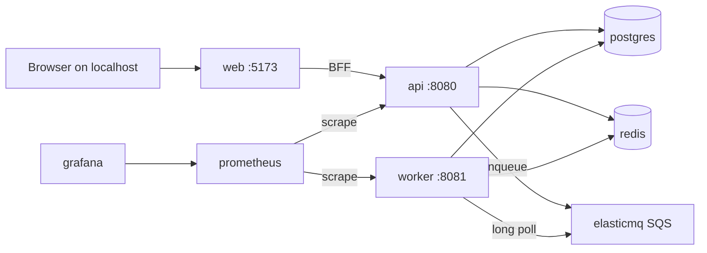

# Architecture

PhishGuard runs as a local Compose stack. The browser talks only to the SvelteKit app. Server loads and form actions call the Go API and forward the session cookie.

All published ports bind to `127.0.0.1`.

The API records campaigns and enqueues delivery. The worker consumes ElasticMQ, writes inbox rows, and updates campaign stats in Redis. Prometheus scrapes the API and worker. Grafana is provisioned from `monitoring/`.

`backend/cmd/lambda` wraps the same delivery function for an optional LocalStack deployment. Do not attach the Lambda consumer and the Compose worker to one queue.

Folder READMEs under `deploy/`, `monitoring/`, `infra/terraform/`, and `scripts/` describe each area.
