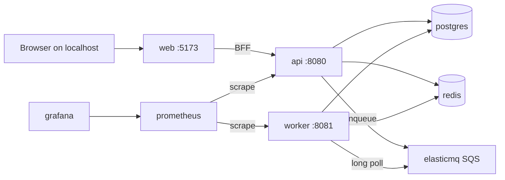

# Learn PhishGuard

Follow in order. Each note points at the real files.

1. [Run the app](01-run-the-app.md)
2. [Campaign service and SQL](02-campaign-and-sql.md)
3. [Worker and SQS](03-worker-and-sqs.md)
4. [SvelteKit BFF](04-sveltekit-bff.md)
5. [Prometheus + Grafana](05-prometheus-grafana.md)
6. [GitHub Actions](06-github-actions.md)
7. [LocalStack + Terraform](07-localstack-terraform.md) (optional)

## Architecture (everyday Compose)

All published ports bind to `127.0.0.1`. Training only — no real phishing.
